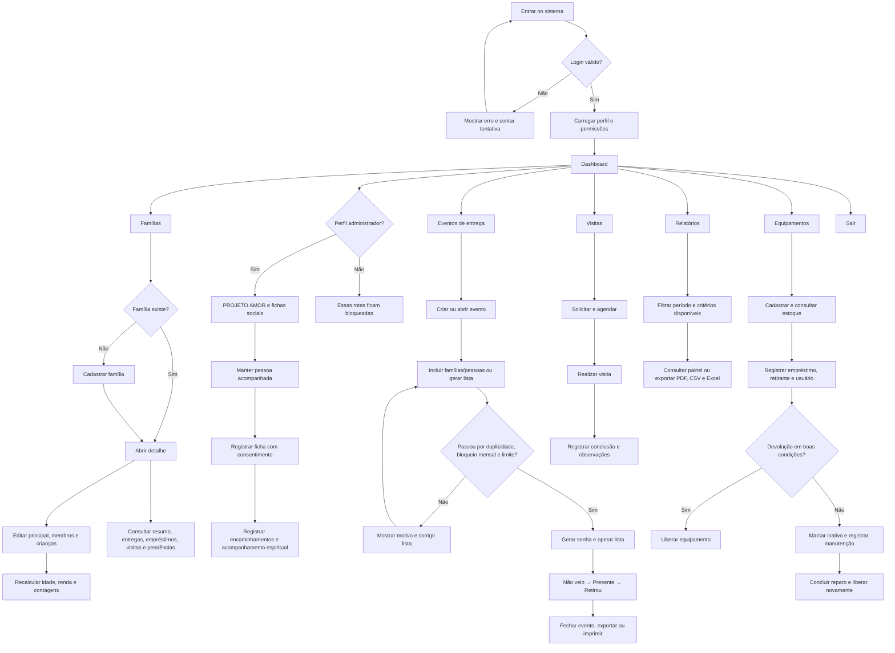

# Fluxograma do sistema

O diagrama mostra o caminho normal de uma pessoa da equipe. Cada acesso protegido passa por autenticação e pela permissão correspondente no servidor.

## Em palavras simples

1. A pessoa entra com seu usuário; o sistema verifica quem ela é e o que pode acessar.
2. A equipe registra a família ou pessoa uma vez e acompanha as mudanças dentro do próprio cadastro.
3. Entregas, empréstimos e visitas ficam vinculados ao registro correspondente.
4. O painel e os relatórios resumem o que foi registrado; não substituem a avaliação da equipe.
5. O administrador mantém usuários e acessa as áreas sociais restritas.
